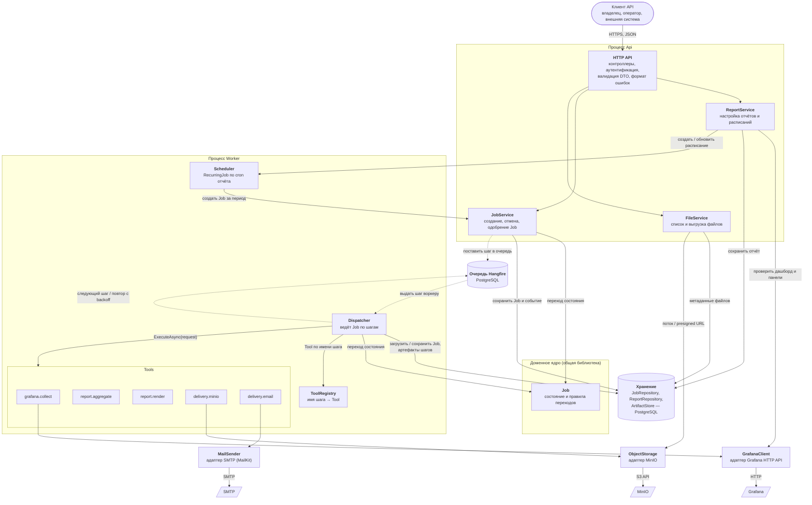
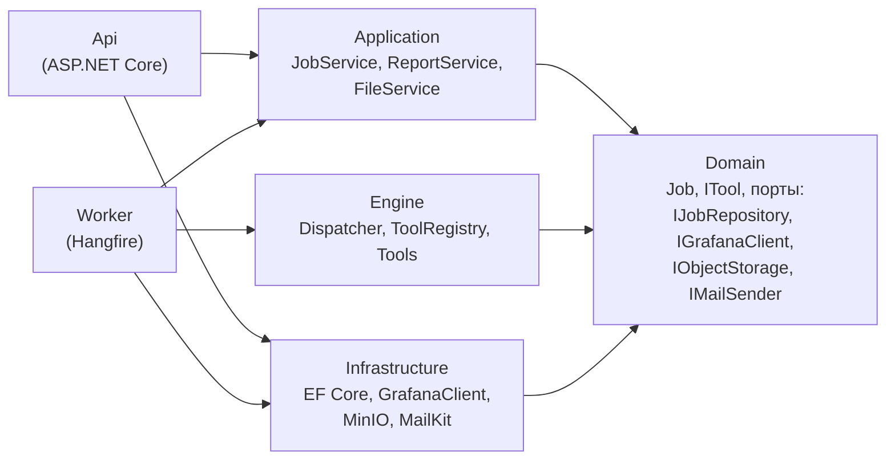
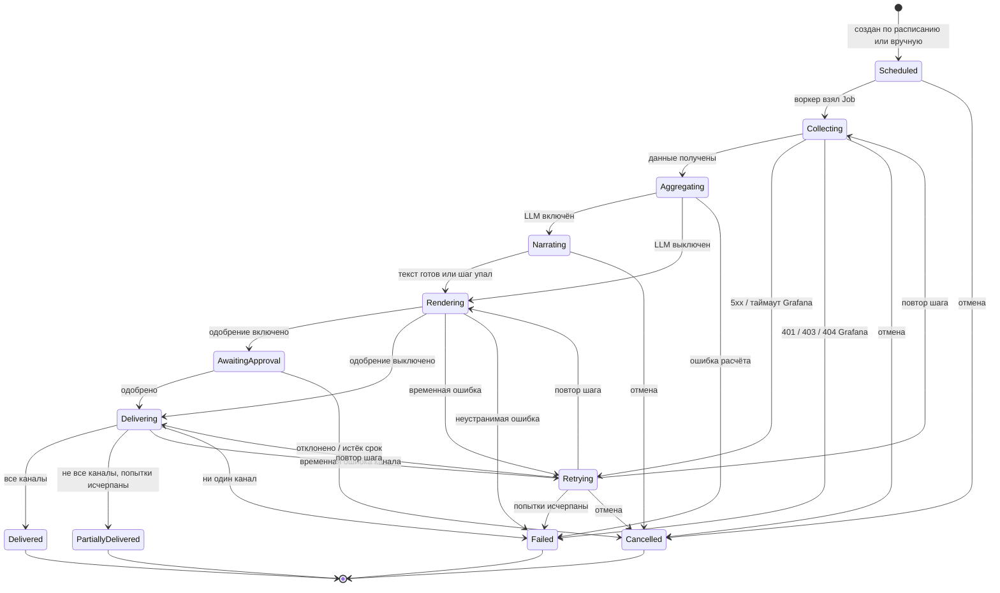

# Архитектура Grafana Reports

Документ описывает систему на двух уровнях: контекст (система целиком и её окружение) и компоненты (что внутри).
Сценарии и жизненный цикл Job — в [requirements.md](requirements.md), контракт API — в [api/openapi.yaml](api/openapi.yaml).

## Схема контекста

**Что показывают стрелки.** Стрелка — **вызов** во время работы: идёт от того, кто начинает взаимодействие,
к тому, кто отвечает. Подпись — что передаётся и по какому протоколу. Пунктир — необязательное взаимодействие
в обход нашей системы (получатель открывает presigned URL напрямую из MinIO).

**Границы.** Внутри системы — API, воркер, планировщик и PostgreSQL: они разворачиваются и обновляются вместе,
поэтому на уровне контекста это один блок. Grafana, MinIO и SMTP — внешние: мы ими не управляем,
они могут быть недоступны, медленными или поменять формат ответа.

| Участник / система | Роль по отношению к Grafana Reports |
|---|---|
| Владелец отчёта | Создаёт и правит отчёты, запускает вручную, одобряет отправку |
| Оператор | Следит за Job, отменяет зависшие, перезапускает упавшие, читает журнал переходов |
| Получатель | Пассивно получает письмо; в систему не ходит |
| Внешняя система | Забирает готовые отчёты через API по сервисной учётной записи |
| Grafana | Источник данных: описание дашборда и данные панелей; сервис ходит от сервисного аккаунта |
| MinIO | Хранилище PDF; живёт по своей lifecycle-политике, может удалить старые файлы |
| SMTP-сервер | Канал доставки писем; может отказать или принять письмо с задержкой |

## Схема компонентов

Один репозиторий, два процесса: **Api** (ASP.NET Core) и **Worker** (Hangfire-сервер). Оба используют одно
доменное ядро и одну базу PostgreSQL. Планировщик и очередь — Hangfire с хранилищем в той же PostgreSQL.

**Что показывают стрелки.** Сплошная стрелка — **синхронный вызов** во время работы: от вызывающего к вызываемому,
подпись — зачем вызывает. Пунктир — **асинхронная передача через очередь**: отправитель не ждёт выполнения.
Зависимости кода (кто чей тип импортирует) на этой схеме не показаны — они ниже, отдельной схемой.

### Ответственность компонентов

| Компонент | За что отвечает | Что скрывает от соседей |
|---|---|---|
| **HTTP API** | Принимает запросы, проверяет аутентификацию и роль, валидирует DTO по контракту, превращает исключения в единый формат ошибок | HTTP: маршруты, коды ответов, JSON-сериализацию, заголовки `Idempotency-Key` и `Authorization` |
| **ReportService** | Создаёт и правит отчёты: проверяет дашборд и панели в Grafana, сохраняет настройку, обновляет расписание | Порядок проверок при сохранении и то, что расписание живёт в Hangfire |
| **JobService** | Создаёт Job (с проверкой дубля на «отчёт + период» и идемпотентности), отменяет, одобряет, отклоняет | Как ищется дубль, как хранятся ключи идемпотентности, что шаг ставится в очередь |
| **FileService** | Отдаёт список файлов и сам файл или presigned URL, проверяет право чтения | Где физически лежит файл и как формируется ссылка; существует ли файл, если прав нет |
| **Scheduler** | По cron и часовому поясу отчёта вычисляет границы периода и просит JobService создать Job | Cron-выражения, часовые пояса, переход на летнее время, пропущенные запуски |
| **Dispatcher** | Берёт Job, выбирает Tool для текущего шага, вызывает его, превращает результат или ошибку в переход Job, решает о повторе | Порядок шагов, политику ретраев и backoff, где лежат промежуточные результаты |
| **ToolRegistry** | По имени шага выдаёт Tool; неизвестное имя — ошибка `unknown_operation` | Список конкретных Tool и как они создаются (DI) |
| **Tool** | Выполняет один шаг: собрать данные, посчитать итоги, собрать PDF, доставить в канал. Контракт — [tool-contract.md](tool-contract.md) | Как именно сделан шаг: запросы к Grafana, библиотеку графиков и PDF, формат письма |
| **Job** | Хранит состояние, проверяет, что переход разрешён, записывает событие перехода | Таблицу разрешённых переходов (см. диаграмму состояний ниже) |
| **Хранение** | Сохраняет отчёты, Job, `job_events`, `report_files` и артефакты шагов; переход Job — условный `UPDATE` с версией | SQL, EF Core, схему таблиц, оптимистичную блокировку |
| **Очередь Hangfire** | Доставляет шаги воркеру «хотя бы один раз», держит отложенные повторы | Хранилище и механизм невидимости задач |
| **GrafanaClient** | Читает описание дашборда и данные панелей, подставляет переменные и период | Grafana HTTP API: URL, токен сервисного аккаунта, формат фреймов, таймауты |
| **ObjectStorage** | Кладёт файл, читает его, выдаёт presigned URL | S3 API, бакеты, ключи объектов, учётные данные MinIO |
| **MailSender** | Отправляет письмо с вложением списку адресатов | SMTP, MailKit, TLS, учётные данные почты |

### Зависимости кода

**Что показывают стрелки.** Здесь стрелка — **зависимость кода**: проект слева ссылается на проект справа и
использует его типы. Все стрелки сходятся к `Domain`: ядро не знает ни ASP.NET, ни EF Core, ни Hangfire.
Адаптеры из `Infrastructure` реализуют интерфейсы (порты), объявленные в `Domain`, и подключаются через DI
только в `Api` и `Worker`. Поэтому направление вызовов (Dispatcher → GrafanaClient) и направление зависимости
кода (GrafanaClient → интерфейс в Domain) противоположны.

## Диаграмма состояний Job

Источник правды — таблица переходов в [requirements.md](requirements.md#жизненный-цикл-job); здесь она же в виде
схемы и с запрещёнными переходами. Правило живёт в `Job`: вызывающий код (Dispatcher, JobService) только
просит перейти, а `Job` разрешает или отклоняет.

**Что показывают стрелки.** Стрелка — разрешённый переход, подпись — событие, которое его вызывает.
Перехода, которого нет на схеме, не существует: `Job` его отклоняет.

**Кто инициирует переходы.**

| Инициатор | Переходы |
|---|---|
| Dispatcher (воркер) | Все переходы между шагами, в `Retrying`, `Failed`, `Delivered`, `PartiallyDelivered` |
| Пользователь через API | `→ Cancelled` (`POST /jobs/{jobId}/cancel`), `AwaitingApproval → Delivering` (`approve`), `AwaitingApproval → Cancelled` (`reject`) |
| Таймер | `AwaitingApproval → Cancelled` по истечении срока одобрения; `Retrying → шаг` по backoff |

`Narrating` в первой версии не реализуется: флаг LLM выключен, и Dispatcher всегда идёт `Aggregating → Rendering`.
Состояние оставлено в схеме, чтобы добавить шаг без изменения контракта.

### Запрещённые переходы

Каждая попытка запрещённого перехода пишется в `job_events` с типом `transition_rejected` (откуда, куда, кто просил),
состояние Job при этом **не меняется**.

| Попытка | Почему запрещено | Что ответит система |
|---|---|---|
| Любой переход из `Delivered`, `PartiallyDelivered`, `Failed`, `Cancelled` | Финальные состояния неизменны; повторный запуск — новый Job | API: `409 invalid_transition`, в `details` — `currentState` и `allowedActions: []`. Для повтора — `POST /reports/{reportId}/jobs` |
| Отмена из `Aggregating`, `Rendering` | Шаги локальные и короткие (секунды); отмена дождётся следующего состояния, где она разрешена | API: `409 invalid_transition`, `details.allowedActions: []`; клиент повторяет отмену позже |
| Отмена из `Delivering` | Часть каналов могла уже получить отчёт, письмо отозвать нельзя | API: `409 invalid_transition` |
| `approve` / `reject` не из `AwaitingApproval` | Одобрять нечего: отчёт ещё не собран или уже ушёл | API: `409 invalid_transition` |
| `Rendering → Delivering` при включённом одобрении | Отчёт не должен уйти без подтверждения владельца (SC-2) | Dispatcher получает `InvalidTransitionException`, шаг завершается без доставки |
| Пропуск шагов: `Scheduled → Rendering`, `Collecting → Delivering`, `Aggregating → Delivering` и т. п. | Каждый шаг использует результат предыдущего | Dispatcher: `InvalidTransitionException`, Job остаётся в текущем состоянии, ошибка в лог с `jobId` |
| `Aggregating → Retrying` | Расчёт — чистая функция от собранных данных: повтор даст ту же ошибку | Ошибка расчёта ведёт только в `Failed` |
| `Retrying →` шаг, отличный от упавшего (например, упал `Delivering`, повтор в `Collecting`) | Повтор только упавшего шага: уже собранные данные и доставленные каналы не трогаем (SC-6) | Dispatcher: `InvalidTransitionException`; шаг для повтора хранится в Job как `retryStep` |
| `Retrying → Aggregating`, `Retrying → AwaitingApproval` | Эти шаги не повторяются через `Retrying` | Dispatcher: `InvalidTransitionException` |
| Переход из устаревшего состояния (второй воркер выполняет тот же шаг) | Hangfire доставляет «хотя бы один раз» — шаг может выполниться дважды | Условный `UPDATE ... WHERE state = @expected AND version = @version` не проходит; шаг завершается без побочных эффектов |
