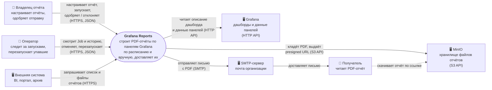

# Архитектура Grafana Reports

Документ описывает систему на двух уровнях: контекст (система целиком и её окружение) и компоненты (что внутри).
Сценарии и жизненный цикл Job — в [requirements.md](requirements.md), контракт API — в [api/openapi.yaml](api/openapi.yaml).

## Схема контекста

**Что показывают стрелки.** Стрелка — **вызов** во время работы: идёт от того, кто начинает взаимодействие,
к тому, кто отвечает. Подпись — что передаётся и по какому протоколу. Пунктир — необязательное взаимодействие
в обход нашей системы (получатель открывает presigned URL напрямую из MinIO).

**Границы.** Внутри системы — API, воркер, планировщик и PostgreSQL: они разворачиваются и обновляются вместе,
поэтому на уровне контекста это один блок. Grafana, MinIO и SMTP — внешние: мы ими не управляем,
они могут быть недоступны, медленными или поменять формат ответа.

| Участник / система | Роль по отношению к Grafana Reports |
|---|---|
| Владелец отчёта | Создаёт и правит отчёты, запускает вручную, одобряет отправку |
| Оператор | Следит за Job, отменяет зависшие, перезапускает упавшие, читает журнал переходов |
| Получатель | Пассивно получает письмо; в систему не ходит |
| Внешняя система | Забирает готовые отчёты через API по сервисной учётной записи |
| Grafana | Источник данных: описание дашборда и данные панелей; сервис ходит от сервисного аккаунта |
| MinIO | Хранилище PDF; живёт по своей lifecycle-политике, может удалить старые файлы |
| SMTP-сервер | Канал доставки писем; может отказать или принять письмо с задержкой |
